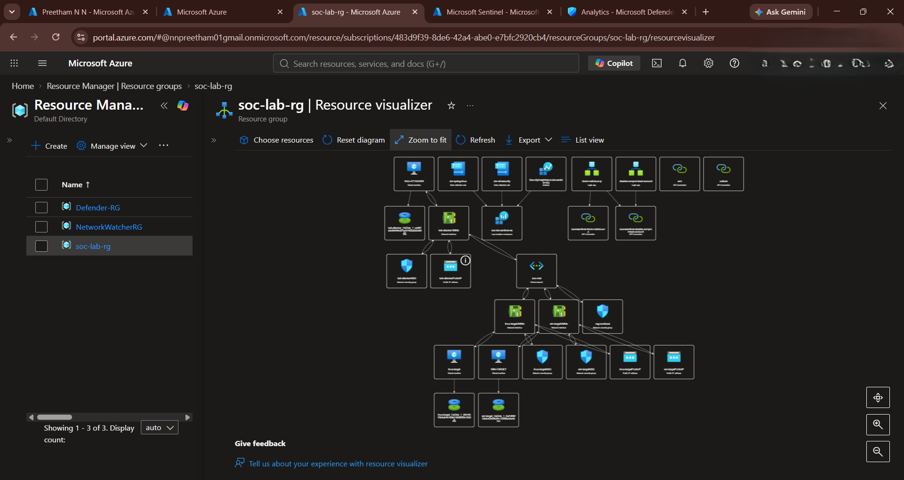
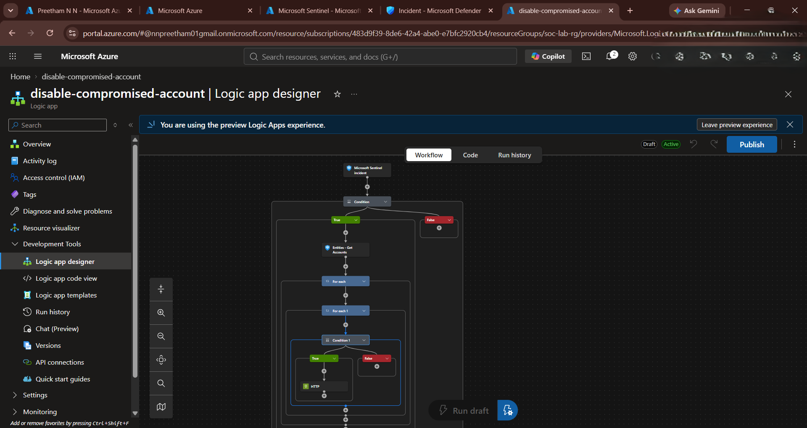
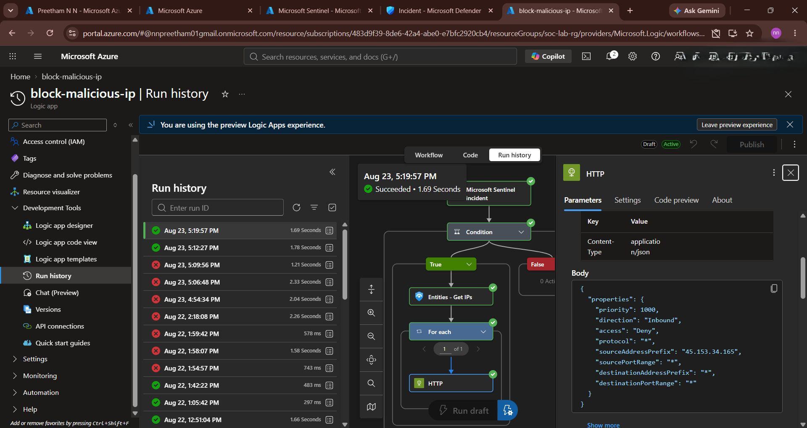
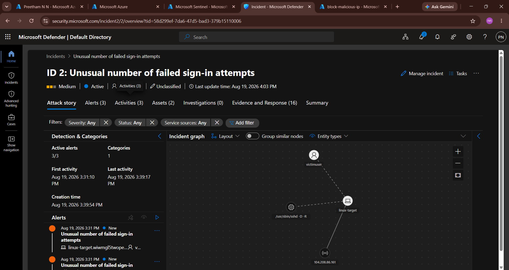

# Diagrams

Add sanitized architecture screenshots/diagrams here.

Before committing an Azure portal screenshot, check that it does not expose:

- subscription ID
- tenant ID
- resource ID
- email address
- public IP
- username
- access token
- secret
- private endpoint
- connection string

Recommended files:

```text
cloud-soc-architecture.png.png
disable-compromised-account-workflow.png.png
block-malicious-ip-run-history.png.png
defender-incident-unusual-sign-in-attempts.png.png
```

## Current diagram set

- Figure 1: Cloud SOC architecture overview
- Figure 2: Disable compromised account workflow
- Figure 3: Block malicious IP run history
- Figure 4: Microsoft Defender incident - unusual sign-in attempts








